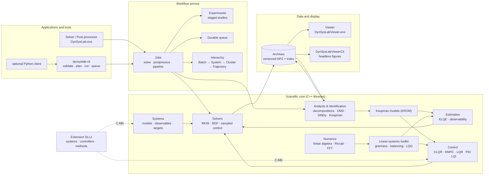
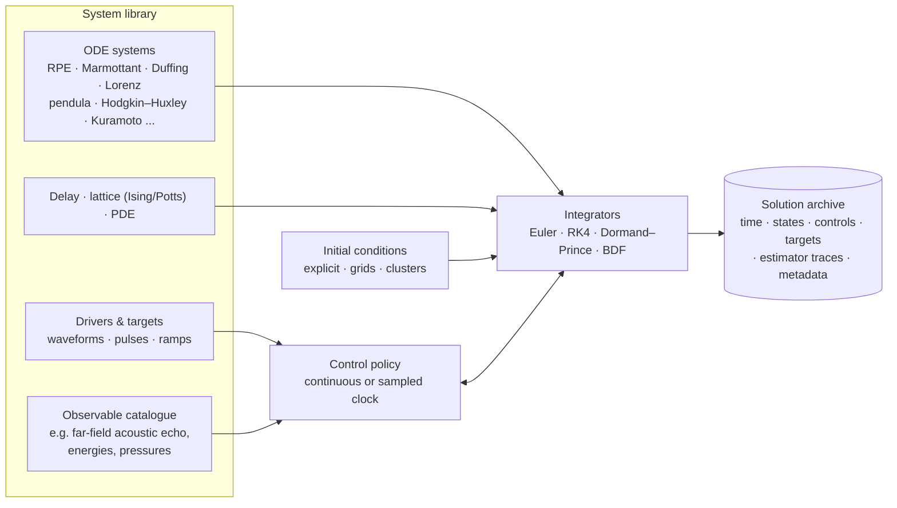
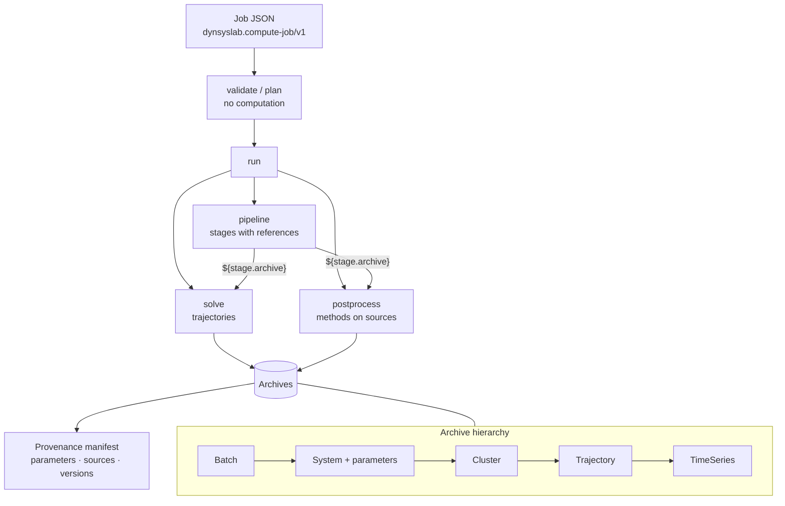
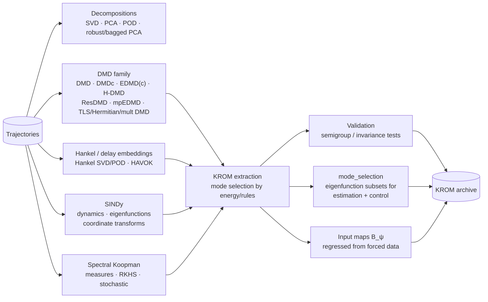
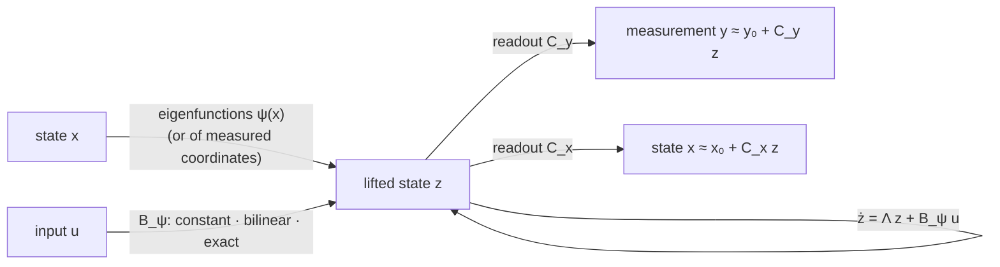
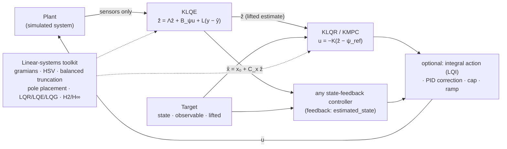
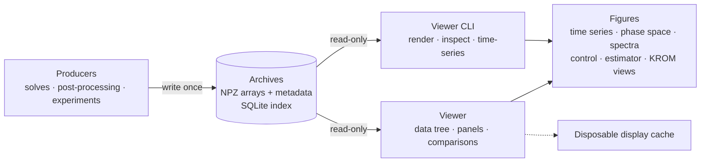
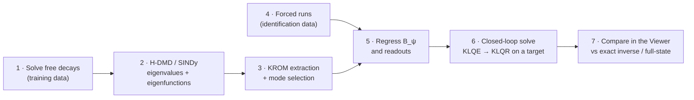

# DynSysLab overview

DynSysLab is a native C++ suite for simulating, analysing, modelling and controlling dynamical
systems. One versioned archive holds every trajectory and every derived object, and three
applications work on it: the **Solver / Post-processor** (`DynSysLab.exe`) runs jobs, the
**Viewer** (`DynSysLabViewer.exe`) displays results, and the command-line tools
(`dynsyslab-cli`, `DynSysLabViewerCli`) do both headlessly for scripts and AI agents.

A typical study goes from equations to a controller in one reproducible chain:

1. **Simulate** a system from a library of ODEs, delay, lattice and PDE models, free or driven.
2. **Analyse** the trajectories: decompositions, Fourier spectra, phase space, Lyapunov screens.
3. **Identify a model**: DMD-family, Hankel/H-DMD, SINDy and spectral Koopman methods produce a
   Koopman reduced-order model (KROM) — eigenvalues, eigenfunctions, readouts and input maps.
4. **Design estimation and control** on that model: Koopman LQE (KLQE) estimates the lifted
   state from sensors, Koopman LQR/MPC (KLQR/KMPC) drives it to a target; classical LQR, PID,
   integral action and a linear-systems toolkit (gramians, balanced truncation, LQG) sit beside.
5. **Close the loop** in a new solve, archive everything, and compare runs in the Viewer.

Every step is a job (`dynsyslab.compute-job/v1`, JSON) that can be planned, validated, run and
re-run; derived archives point back to their sources, so each figure traces to its data.

---

## 1. Structure at a glance



The dependency direction is one-way: applications compose the workflow service, the workflow
composes scientific libraries, and only producers write archives. The Viewer is read-only.
Systems, controllers and post-processing methods can be added as separately compiled DLLs
through a versioned C ABI, without rebuilding the core.

---

## 2. Systems and solvers



- A system supplies its right-hand side, Jacobian, input map, validity domain and an
  observable catalogue with analytic derivatives. Coordinates (dimensional or dimensionless)
  are explicit and recorded.
- Solvers integrate many trajectories per job. A controller is sampled on its own clock;
  with `solver.on_failure: "truncate"` a run that leaves the validity domain is archived up
  to the failure, with the reason.
- Campaign axes (parameter sweeps, initial-condition families) are part of the same job
  contract and run directly or through the durable queue.

---

## 3. Workflow: jobs, experiments and the hierarchy



- **Jobs** are deterministic and versioned. `plan` shows exactly what will run.
- **Experiments** chain stages (e.g. solve → H-DMD → KROM extraction → mode selection → closed
  loop); a stage refers to an earlier stage's archive, parameters can be overridden from the
  command line, and identical stages are reused.
- **Data roles** (free/forced, training, identification, reference) are metadata on archives,
  checked when a method requires, for example, unforced data for eigenfunctions.

---

## 4. Analysis and model identification



- Methods run as post-processing stages on archived trajectories and write derived archives
  that reference their sources.
- A **KROM** stores continuous eigenvalues, eigenfunctions (polynomial, analytic-coordinate or
  scattered/interpolated values), named linear **readouts** (e.g. state, measurement) and
  **control maps** (constant, bilinear or exact B_ψ).
- `mode_selection` scores subsets of eigenfunctions with gramians, Hankel singular values and
  invariance tests, so an estimator and a controller can be built from the same model.

---

## 5. The Koopman model (KROM)



The KROM linearizes the dynamics in eigenfunction coordinates. The same object drives
prediction, estimation (through C_y) and control (through Λ and B_ψ).

---

## 6. Estimation and control



- **Controllers**: prescribed waveforms and pulses, PID, LQR/SDRE, MPC, KLQR and KMPC; all
  share one solver interface and an optional actuator cap.
- **Estimation**: KLQE uses only the configured sensors; it never evaluates eigenfunctions at
  the true state. Output feedback can share the controller's KROM (`feedback: estimate`) or
  hand a decoded state x̂ to any state-feedback controller (`feedback: estimated_state`).
- **Integral action and PID** are general components with KLQR adapters on any KROM readout.
- Analysis methods (`observability`, `controllability`, `linear_systems`) score models
  before they are used in a loop.

---

## 7. Archives and the Viewer



- Completed archives are immutable; derived results reference them instead of copying data.
- The Viewer reads the same archive tree; its CLI renders any panel headlessly, with time
  windows, dimensional units, log scales, axis ranges and multi-run comparisons.

---

## 8. Example: analyse and control a system



```powershell
dynsyslab-cli run examples\native\experiments\rpe-echo-mode-selection\range-pool.json --archive-root archives
DynSysLabViewerCli render --source archives\solutions\rpe\<run>.npz --view "r versus time" --output radius.png
```

Worked case studies (bubble dynamics with echo-only sensing, exact linear references,
coordinate and history models) live under `examples/native/case-studies/` and
`docs/reports/`, each with the jobs that reproduce its figures.

---

## Where to go next

| Goal | Read |
|---|---|
| Install and first solve | [INSTALL.md](INSTALL.md), [START_HERE.md](START_HERE.md) |
| Write jobs and experiments | [architecture/EXPERIMENTS.md](architecture/EXPERIMENTS.md) |
| Koopman models | [architecture/EIGENFUNCTION_MODEL_API.md](architecture/EIGENFUNCTION_MODEL_API.md), [architecture/MODE_SELECTION.md](architecture/MODE_SELECTION.md) |
| Estimation and control | [architecture/ESTIMATOR_MODULE.md](architecture/ESTIMATOR_MODULE.md), [architecture/INTEGRAL_AND_PID_CONTROL.md](architecture/INTEGRAL_AND_PID_CONTROL.md), [architecture/LINEAR_SYSTEMS_TOOLKIT.md](architecture/LINEAR_SYSTEMS_TOOLKIT.md) |
| Figures | [architecture/VIEWER_CLI.md](architecture/VIEWER_CLI.md) |
| Extending the suite | [BUILD_NATIVE.md](BUILD_NATIVE.md) |
| Package boundaries | [../ARCHITECTURE.md](../ARCHITECTURE.md) |
