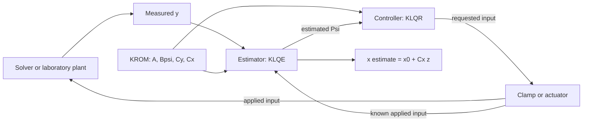

# Measured-output KLQE and KLQR composition

The native pipeline now supports a feedback loop in which a measured observable
drives KLQE, KLQE estimates the KROM coordinates, and KLQR uses those estimates.
The physical state is reconstructed separately through a named output map. The
controller does not need to reconstruct the physical state and evaluate an
eigenfunction on it.

## Boundaries



- **KROM** owns the spectrum, coordinate identity, ordered eigenfunctions, fitted
  control map and named reconstruction maps.
- **Estimator** owns prediction, innovation, gain and estimate. The public
  `core::KoopmanLQEObserver` takes measured numbers and applied inputs, without
  an ODE, sensor evaluator, controller or solver.
- **Controller** remains `core::KoopmanLQRController`, using its existing
  `valueFromLifted` method and feedback law.
- **Workflow** owns `workflow::KoopmanFeedback`, the small composition object.
  Its solver adapter simulates the sensor through an ordinary system observable.
  Only this adapter reads plant truth; that truth never crosses the observer or
  controller boundary.
- **Solver** keeps its existing sampled scalar control policy. It knows nothing
  about KLQE. The adapter maintains an independent observer for each trajectory.

The Estimator and Controller libraries have no dependency on each other. The
new implementation is C++; there is no Python numerical runtime or UI algorithm.

## Equations and timing contract

Let z be the KROM's real split representation of its complex eigenfunctions.
The supported continuous model is

```text
zdot = A z + (b + sum_j z_j Bj) u
y    = y0 + Cy z
xhat = x0 + Cx zhat
```

For a constant fitted map the parenthesized expression is simply B. For the
existing affine bilinear map, equivalently,

```text
zhat_dot = (A + sum_a u_a Na - L Cy) zhat + b u + L (y - y0)
u_requested = -K(zhat) (zhat - z_reference)
```

The standard LQE design computes L from A, Cy and the specified continuous-time
process/measurement noise intensities. Bilinear deployment retains this nominal
gain; it does not claim a nonlinear separation theorem or an optimal EKF.
The existing KLQR law recomputes its local gain for a bilinear map and caches a
constant-map gain. This change adds no new tracking feedforward or integral law.

`observe(t, y, previousAppliedInput)` has an explicit causal contract:

1. The first call latches time and measurement. The estimate is the supplied
   initial real lifted vector; it is never initialized from the true state.
2. Each subsequent call advances from the previous timestamp to t using the
   **previous** held measurement and the input **actually applied** over that
   interval. Neither the current measurement nor the newly requested input is
   used retroactively.
3. It computes predicted measurement/output and current innovation, then latches
   the current measurement for the next interval.
4. Workflow passes the estimated lifted values to KLQR. The actuator clips/gates
   the command and returns that applied value to the solver and, on the next
   tick, to the observer.

Propagation uses an exact matrix exponential for these held signals, including
the input-dependent generator of a bilinear map and conjugate terms. This is
the sampled implementation of the existing **continuous-gain observer**, not a
discrete Kalman measurement update. A current measurement therefore affects
feedback after propagation to the next tick. Choose a measurement period that
resolves the dynamics. R in LQE is a continuous noise convention, not automatically
the variance of an individual sampled sensor reading.

The sensor/controller clock is separate from archive output intervals and
adaptive integrator steps. Repeated/nonincreasing observer timestamps are
rejected. Outside an active-control window, the observer continues to run with
the actual zero input. Windows are evaluated at sample ticks.

## C++ deployment interface

```cpp
#include <dynsyslab/workflow/KoopmanFeedback.hpp>

auto design = dynsyslab::core::designKoopmanLQEFromMeasurements(
    krom, "echo", processCovariance, measurementCovariance, "state");

dynsyslab::workflow::KoopmanFeedback loop(
    krom, design, "regressed", initialRealLifted,
    controlQ, controlR, targetRealLifted,
    dynsyslab::core::KoopmanTargetSpace::realLiftedValues);

// At each measurement tick, previousApplied is actuator feedback for the
// whole preceding hold interval. For the first call it is a zero vector.
auto sample = loop.sample(time, measuredEcho, previousApplied);
auto command = sample.commandedInput;
auto estimatedState = sample.estimate.output;
// Apply command through the actuator, recording the actual input for next tick.
```

Link the workflow composition with `dynsyslab_workflow`. The observer alone
requires `dynsyslab_estimation`; the controller alone requires
`dynsyslab_control`. Construct a new runtime to reset a measurement stream.
Core APIs accept multiple measurement and input channels. The existing ODE
solver adapter currently accepts one scalar input.

The runtime snapshots the KROM/maps at construction. Changing a source model
afterward cannot silently change one participant while leaving another stale.
`KoopmanModel::valuesFromSplit` supplies the inverse real-to-complex layout
conversion without evaluating polynomials, accessing states or replaying history.

## Standard solve job

Use the usual `dynsyslab.compute-job/v1`, `kind: solve` job with this controller
block. The KROM path is a local artifact supplied by the user, not bundled data.
The named maps must already exist in that KROM.

```json
{
  "controller": {
    "kind": "klqr",
    "settings": {
      "krom": "path/to/selected-krom.npz",
      "control_representation": "regressed",
      "sample_time": 0.001,
      "Q": 1.0,
      "R": 0.1,
      "control_limit": 0.5,
      "estimator": {
        "kind": "klqe",
        "measurement": "echo",
        "measurement_observable": "far_field_acoustic_echo",
        "output": "state",
        "process_covariance": 1.0,
        "measurement_covariance": 0.001,
        "initial_lifted": [0.0, 0.0]
      }
    }
  }
}
```

The two initial values above are an example for a two-real-coordinate KROM;
use the exact real lifted dimension of the selected model. Omitting
`initial_lifted` supplies zeros. Omitting the target regulates toward zero
lifted coordinates. An explicit target uses the standard constant/waveform/
trajectory target resolver and `space: lifted`, `observable`, or `state`.
For `lifted`, the target vector is in real split order. A history KROM cannot
use an instantaneous physical-state target; supply its lifted or observable
target trajectory instead.

The four penalty/covariance options accept scalar multiples of identity,
diagonal vectors or flat row-major square matrices. Optional
`measurement_offset` and `output_offset` are known affine baselines;
they must match the convention used to fit Cy and Cx.

For multiple sensor observables, use `measurement_observables: ["y1", "y2"]`
in place of `measurement_observable`. Outputs are concatenated in that order
and must match the rows of the named reconstruction. This does not automatically
combine separately named Cy maps or infer their physical meanings.

An external fitted map can use the existing `control_map_archive` and
`control_map_prefix` settings, with existing identity checks. Mode selection,
physics/scaling checks and explicit legacy-binding exceptions use the normal
KROM loader. Prefer fitting B after choosing the model realization/subset.
The controller and observer use the same selected map.

`solver.control_sample_time` overrides `settings.sample_time`; otherwise the
output step is the fallback. `continuous_rhs` control is rejected because
adaptive trial evaluations cannot safely advance observer state.

Run the complete job through the ordinary compiled CLI:

```powershell
dynsyslab-cli plan path/to/job.json
dynsyslab-cli run path/to/job.json --archive-root path/to/local/archives
```

## Diagnostics and provenance

The normal immutable solution archive still stores truth and applied control on
the solver output grid. Extra arrays use the **independent `estimator_time`
axis**; do not align them with `time` by row index:

| Array | Meaning |
|---|---|
| `lifted_estimate` | Estimated z in KROM real split order |
| `state_estimate` | Reconstructed named output, when requested |
| `measurement_values` | Sensor measurements supplied to KLQE |
| `measurement_estimate` | y0 + Cy zhat |
| `innovation` | Measured minus estimated observable |
| `commanded_input` | KLQR request before clipping or gating |
| `applied_input` | Input held from this tick to the next |
| `previous_applied_input` | Input used to advance the preceding interval |

Gain, Cy and optional Cx are also archived. The existing controller configuration
stores offsets, noise settings, target, input bounds and archive pointers.
Binding evidence records model identity, map provenance, reconstruction names,
composition contract version and observer integration convention.

## Validation and limits

Focused native tests cover analytic held-input propagation, unchanged autonomous
observer results, complex/conjugate bilinear maps, immutable model snapshots,
input/time/dimension checks, and rejection of incompatible model designs and
discrete-only input maps.

The workflow test uses an exact unstable linear Duffing fixture:
`x'' = 2x - x' + u`, with eigenfunctions `2x + x'` and `-x + x'`.
It estimates both modes from position alone, stabilizes two opposite initial
conditions, and checks clipping, gating, archive clocks, independent observer
streams, RK45 and BDF sampling. This is an infrastructure benchmark, not a new
claim of successful echo-only RPE control.

For RPE, performance still depends on autonomous closure, useful Cy/Cx,
forced-data validity of B, coverage and noise. The interface accepts history
KROMs without requiring history values online, but an observer cannot repair a
model whose selected coordinates do not predict the controlled dynamics.
An unstable hidden mode, a weak measurement, or a deficient input map remains a
scientific problem to diagnose. Accurate echo fit alone is insufficient evidence
of accurate state reconstruction.

Verification on 2026-11-05: all 113 native regression tests passed, including the
two new runtime/composition tests. The exact fixture ended at state norm
1.20e-8 and state-estimation error 2.19e-10 for both initial conditions. Compiled
CLI plan/run and the isolated package smoke gate passed. The architecture audit
reported zero boundary violations, dependency cycles or broken documentation
links. These checks establish software behavior, not robustness of an RPE fit.

The current runtime uses continuous A, L and B. Discrete spectra may provide
explicitly associated continuous rates, as in the existing framework, but a
discrete input map is never silently converted to B. Actuator dynamics,
measurement feedthrough Du, missing measurements and arbitrary within-interval
input changes are not modeled by this held-input adapter.
