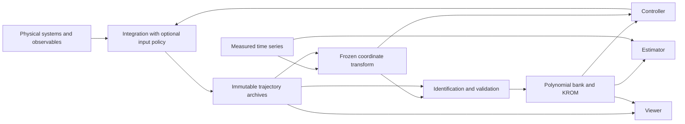

# Pipeline boundary refactor — 2026-10-31

Status: complete. Native builds, regression tests, scientific parity, isolated
packaging and installed Solver/Viewer initialization verified on 2026-10-31.

## Scope and invariants

Implement the approved separation of physical systems, integration, observation
processing, identification, extracted ROMs, control, estimation, and workflow.
Reuse native algorithms and canonical archives. Do not refit scientific records,
change the feedback law, or infer continuous input maps from discrete maps.
Existing working-tree changes and completed scientific archives are preserved.

## Acceptance checklist

- [x] Shared compatibility checks for physical parameters, coordinates, model/map
  identity, time domains and sampling; explicit, recorded exceptions for transfer.
- [x] Coordinate/lifted-input controller APIs, retaining state-based adapters.
- [x] Measurement-only estimator initialization and optional output reconstruction.
- [x] Reusable frozen observation transforms and independent per-stream buffers;
  measurement-only data accepted by workflow without invented physical state.
- [x] Existing echo recipe composes reusable stages; no refitting at deployment.
- [x] Continuous/discrete consumers reject incompatible combinations early.
- [x] Runtime libraries do not depend on fitting or candidate-screening libraries.
- [x] Constant-map KLQR gain caching preserves the numerical feedback result.
- [x] Public API and compiled workflow/CLI gates, focused tests, numerical parity,
  complete native regression suite, isolated package and installed-app checks.

## Verification baseline

The initial native doctor succeeds and CTest registers 106 tests. The advisory
legacy architecture audit reports one >1000-line Python research script, one
legacy Python application/archive boundary violation, and documentation issues.
These are pre-existing, not failures introduced by this refactor. Its default
Windows console encoding fails to print an arrow; `python -X utf8 -m quality
--format markdown` successfully reports the audit.

## Implementation record

The implementation and verification are complete. The existing scientific
algorithms and feedback laws are retained; the changes establish explicit
contracts and reusable composition around them. See the verification record below.

## Responsibilities and dependency direction



The workflow composes these services. UI and CLI use that workflow. A coordinate
transform is neither the physical system nor an eigenfunction fitter. A fitted
ROM owns expressions, spectra, optional input/output maps and provenance; it does
not run an SVD during evaluation. Physical systems and integration remain distinct
public services within the existing foundation build module.

| Native target | Responsibility |
| --- | --- |
| `dynsyslab_foundation` | Systems, integration, observations, time series and archive primitives |
| `dynsyslab_eigenfunctions` | Immutable polynomial evaluation, spectra and legacy DTO adapters; no fitter dependency |
| `dynsyslab_identification` | SINDy, boundary fitting and eigenvalue optimization |
| `dynsyslab_observation` | Frozen history transforms, per-stream buffers, projection and transform archives |
| `dynsyslab_history_koopman` | Pooled Hankel/EDMD fitting and retained history input regression |
| `dynsyslab_spectral` | DMD, DMDc and EDMDc identification |
| `dynsyslab_koopman` | Runtime ROM, validation, input/output maps, archive binding and inspection |
| `dynsyslab_control` | Runtime feedback and observer services (KLQR, classical control, KLQE; `dynsyslab_estimation` was merged into it on 2026-11-15); no fit or candidate-screening dependency |
| `dynsyslab_workflow` | Typed service composition, jobs and immutable publication |

`dynsyslab_core` remains the umbrella target for existing clients. Deployment
clients can link only the runtime targets. This preserves source compatibility;
changed C++ layouts require rebuilding clients against matching headers/DLLs.

## Scientific binding

`systemCompatibilityDifferences` compares resolved physical parameters, equation
versions and scaling. It ignores ICs, forcing and preset labels when the resolved
physics agrees. Archive loaders reject conflicting parameters. An explicit
`systemTransferReason` permits a recorded transfer experiment **without rewriting
the trained model's physical adapter**. Its exact Jacobian still belongs to its
training physics. A transfer is not certification of predictive accuracy.

Low-level explicit-system loaders retain access to legacy records with incomplete
provenance and label them `unverified-legacy`. Workflow consumers require
`unverified_legacy_reason` for that case. New workflow control accepts an intentional
`system_transfer_reason`. Binding evidence is retained on the ROM, after extraction,
in saved models and in controlled-solve metadata.

`koopmanModelIdentity` hashes the ordered coefficients, dictionary, normalization,
coordinate/provider contract, spectrum and time convention, input dimension and
optional physics. Dataset paths, errors and attached control maps are excluded.
Input maps bind to this identity: matching dimensions alone do not establish that
mode order, phase/gauge or normalization agree. Extracting a mode subset produces
a new identity and binds the existing mathematical row/principal restriction to
that subset. It does not refit the map or assert that a bilinear restriction is exact.

Independent legacy map attachment requires `unverified_control_map_reason`.
Frozen-history legacy attachment similarly requires `unverified_transform_reason`
when the old KROM has no content identity. A known conflicting identity cannot be
overridden by a legacy reason. `krom-info` exposes model identity and binding evidence.

## Coordinate processing

`FrozenHistoryTransform` owns an immutable shared basis, retained-coordinate order,
measurement name, sampling interval and units. `CausalHistoryProjector` owns only
its stream's ring buffer and clock. Different streams share basis storage while
keeping independent warmup and history. Timestamped ingestion rejects missing,
duplicate, reversed or differently spaced measurements before changing the buffer.

The retained convention is `xi_j = U_j^T h / sigma_j`, with `h` ordered from oldest
to newest. The fitting RMS scale is recorded; the runtime does not divide by it
a second time. This preserves the previous native numerical convention. The first
coordinate appears after `delays` observations, at the final sample's timestamp;
there is no zero padding or future data. Offline FFT projection and the online
ring-buffer calculation are compared in tests.

Transforms use `dynsyslab.history-transform/v1` inside the existing NPZ format.
They may be standalone artifacts or embedded in KROM archives. Import supports
the earlier native echo archive arrays and computes a content identity from them.
Changing a basis, selection, singular normalization, measurement or clock changes
its identity. Loading/evaluating a transform never refits it.

Two compiled post-processing stages are available through `executeJob`, the
existing workflow C ABI and `dynsyslab-cli run`:

```json
{"name":"history_basis","settings":{"observation_array":"echo","delays":100,
 "hankel_rank":4,"coordinate_rank":2,"decimation":1}}
```

```json
{"name":"history_projection","settings":{"observation_array":"echo",
 "transform":"C:/data/frozen-basis.npz","decimation":1}}
```

The first pools independent unforced trajectories without crossing boundaries.
The second transforms each source independently, checks the sampling interval,
measurement identity and declared units, and publishes coordinates after warmup,
with a pointer to the frozen transform. Unit conversion and resampling must be
explicit. The basis inherits declared measurement units unless settings supply
the same units; conflicting overrides fail.
Controls remain referenced in their source archive; projection does not silently
average a forcing history when decimating observations.

The echo convenience recipe uses the same observation reader, fitter, projector,
frozen-transform contract and canonical KROM encoder. Measurement-only archives
need `time` and the named scalar measurement array, with unforced/training
provenance. No `r`, `rdot` or invented physical system is needed. Where physics is
declared, pooled training and validation must agree. The existing echo recipe's
candidate-selection mathematics is unchanged.

Projected coordinates can feed the standard DMD → SINDy stage sequence. SINDy
then uses measured derivatives or finite differences in those coordinates, never
a physical RHS. The polynomial representation is identical. This remains a
continuous generator fit with derivative-estimation limitations; it is not a new
claim that finite-dimensional history coordinates are Markov or injective.
Measurement-only sources may declare `input_dimension` in the SINDy settings
for subsequent control-map regression. This specifies actuator count without
inventing equations of motion; a declared physical system must agree with it.

## Controllers and estimators

`KoopmanLQRController` and `KoopmanMPCController` provide `valueFromCoordinates`
and `valueFromLifted`. The latter takes mode-ordered complex values; `splitValues`
uses the existing real/imaginary realization. Targets may be physical state,
polynomial coordinates or explicitly supplied real lifted values. Existing
`value(time, state)` remains an adapter, including the exact state-Jacobian map.
Direct coordinate/lifted calls require a stored approximate input map.

KLQR still computes `u = -K (z-z_target)` using continuous CARE. A constant map
reuses its gain. Changing its coefficients invalidates that cache; variable maps
retain the previous per-evaluation solve. No tracking feedforward, integral action,
new optimization method or changed Q/R convention was introduced.

Standard simulated history control loads the frozen transform, samples its named
observable on the measurement clock, warms up with `warmup_input` (default zero),
and supplies coordinates to the same controller. Each trajectory has its own
controller/buffer. History ingestion cannot run on adaptive RHS evaluations.
`history_transform` may point to a standalone artifact; otherwise an embedded
transform is used. Coordinate targets use `target.space = "observable"`.

`designKoopmanLQEFromMeasurements` requires the measurement reconstruction and
noise covariances. Output reconstruction is optional. `runKoopmanLQEFromLifted`
accepts an initial lifted estimate, including zero, without physical-state access.
The original state-initialization interface delegates to this runner and is tested
for identical numerical results. The workflow reads measured arrays directly;
physical truth is optional diagnostic evidence. Without a decoder, `values` are
explicitly labeled `real-lifted`, not physical state.
An optional physical-output decoder also works when only sensor measurements are
present. Sensor arrays are not used as truth merely because the archive declares
physical parameters or contains an array named `values`.

The retained LQE update assumes its autonomous linear lifted model with held
measurements. This refactor does not add an unknown-input estimator or a new
forced-observer design. Its suitability on driven measurements remains a modeling
question and must not be inferred from successful software execution.

Continuous controllers require finite continuous rates and a continuous input map.
An EDMDc discrete input map is never silently substituted or divided by dt.
The older explicitly called history-regression conversion retains its documented
frozen-map zero-order-hold approximation; its assumptions are not made automatic
by this refactor. Eigenfunction defects, observability and control authority still
require scientific validation on independent appropriate datasets.

## Verification record

Focused checks currently pass for physical mismatches, identity/order mismatches,
legacy overrides, archive round trips, continuous/discrete rejection, controller
parity/cache invalidation, optional observer decoding, online/offline projection,
clock failures, independent streams, measurement-only training/estimation and the
standard controlled integrator. A test client links only observation and control
runtime libraries. The default unbounded echo fit interval now serializes as JSON
`null` rather than invalid infinity tokens; numerical interval selection is unchanged.

| Gate | Result |
| --- | --- |
| Release build and native suite | **110/110 passed**, including Solver/Viewer, C ABI, CLI, archive and control tests |
| Minimal native build, linear-algebra fitting/archive I/O disabled | Built successfully; **15/15 passed** |
| Fixed scientific parity baseline | **15,630 quantities**, 15 modes and five unforced RPE trajectories; maximum scaled difference **0** |
| Historical Duffing/RPE KLQR comparison | Original numerical assertions passed for exact, constant and bilinear maps |
| Isolated installed package | Passed; native solve → frozen history basis → projection exercised through CLI, no Python runtime |
| Runtime dependency inspection | Eigenfunction/observation DLLs depend on foundation; control/estimation depend on Koopman and numerics, with no fitter or screening dependency |
| Installed applications | Doctor, capabilities and Solver/Viewer initialization passed; 10 installed executable/DLL hashes match the verified build |
| Final whitespace check | `git diff --check` passed; Windows line-ending notices only |

The historical case-study JSON jobs now explicitly acknowledge their legacy
provenance. Their embedded physical parameters were checked against the old
spectrum metadata. The two external RPE map jobs also acknowledge the missing
legacy model identity. No fixture archive, eigenfunction coefficient, Q/R,
target, baseline or numerical tolerance was changed.

The minimal build is in `build/runtime-minimal`. The standard suite is in
`build/native-suite-fast`; CTest retains its log under `Testing/Temporary`.
The scientific parity client and frozen baseline are in
`build/eigenfunction-api-parity`. The package gate uses only its disposable
`build/native-suite-fast/package-smoke` directory. Installation used the standard
`tools/Install-DynSysLabNative.ps1` after the full test and package gates passed.
The installed root is `%LOCALAPPDATA%/Programs/DynSysLab`.

Existing scientific archives remain untouched. No experiments were refitted or
published, and no Git commit or push was part of this refactor.

## Remaining legacy debt and scientific limits

The audit still reports the pre-existing 1,043-line Python research script
`tools/analyze_rpe_echo_sampled_koopman.py`, legacy archive access in
`compute_workbench/cli.py`, four unindexed documents and one broken documentation
link. These are outside the native boundary refactor; the maintained native
tree has no >1,000-line file and no new size or boundary violation was introduced.
Legacy readers and naming adapters remain intentional compatibility surfaces.

This refactor does not establish that a two-coordinate echo history is Markov,
injective, or sufficient for control. It does not improve an eigenfunction or
input map by itself. Autonomous validity, driven prediction quality, input-map
identifiability and control performance still need appropriate validation.
The retained continuous KLQR and autonomous lifted LQE retain their documented
modeling assumptions. Generic coordinate validation is available through the
native API; automatic physical-state validation cannot substitute raw states for
a history provider.
