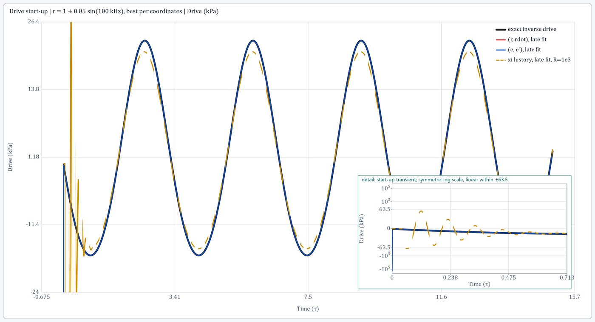
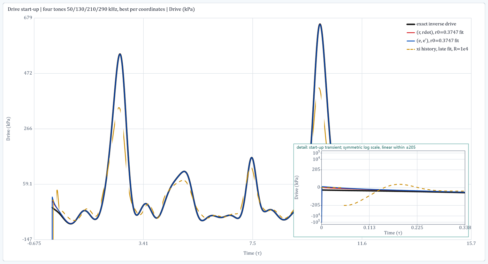

# Viewer inset design: two examples of good practice (2026-11-15)

These two Viewer plots are the reference for how a time-series panel should handle a short, very large start-up transient. They are KLQR drive commands for the viscous RPE: (r, ṙ) in red, (e, e') in blue, ξ in gold and the exact inverse drive in black. Every element below is produced automatically by Viewer (`automaticDetailInset` in `Model.cpp`; `overlayLayout` and `inset` in `PlotFigureDrawing.cpp`), with no per-plot tuning.

| Mild target, 1 + 0.05 sin (100 kHz) | Hard four-tone target |
|---|---|
|  |  |

## What makes them good

1. **Both panels carry information.** The start-up spike reaches −2 × 10⁵ kPa, yet the main panel keeps the meaningful range (±24 kPa mild, −147…679 kPa hard). Under the old policy the main panel was a flat line under one vertical spike.

2. **The inset shows the interesting episode, not just the spike.** Its time window starts at the first off-scale sample. It then runs for as long as the traces disagree markedly with one another: ξ ringing as it attaches to the target (τ 0–0.71 mild, τ 0–0.34 hard). Short lulls are tolerated. The window may cover at most 30% of the record, and every off-scale sample must fall inside it; otherwise the old behaviour applies (recurring bursts stay on the main panel).

3. **The inset scale suits its content.** When the episode spans decades beyond its on-scale behaviour, the inset uses a symmetric log ordinate:
   - **Linear core:** set to the episode's on-scale behaviour (±63.5 kPa mild, ±205 kPa hard), so the ringing is drawn linearly.
   - **Compressed decades:** decades beyond the core are drawn at 0.35 of the core half-height, so the core fills about half the inset.
   - **Centring:** the limits are symmetric about zero in the transformed coordinate, which centres the core vertically.

4. **The inset is a real plot.** It has its own:
   - opaque background (main-panel curves never show through);
   - grid, ticks and tick labels;
   - axis titles in the main panel's units.

   The heading names the window and states the scale ("symmetric log scale, linear within ±205").

5. **The tick labels are unambiguous.**
   - **Values, not exponents:** the axis stays in physical units (kPa), and ticks are values: 0, the ±core edges, then signed decades ±10ᵏ well clear of the core. Exponent-only labels would need the axis to be log₁₀|y|, which cannot show zero, sign or the linear core.
   - **No crowding:** ticks that would sit within about 14 px of an already placed tick are dropped.

6. **Overlays stay in conventional places unless there is a real reason.** The legend goes top right and the inset bottom right.
   - **Reasons to move:** either overlay moves only if it would hide the inset's own episode in the main panel, or a prominent extreme (a figure maximum or minimum that stands more than 5% of the range clear of the extremes elsewhere).
   - **Not a reason:** repetitive, uniform data under an overlay.
   - **When both move:** they are placed jointly, in distinct corners, at the inset's full size unless only a smaller one avoids hiding something that matters.

## Where the code lives

- **`viewer/native/src/Model.cpp`:** `automaticDetailInset` and `transientEpisode` choose the episode, the window, the symmetric-log core and the main-panel range.
- **`viewer/native/src/PlotPresentation.cpp`:** `automaticAxisLimits` applies the main-panel range when the transient moves to the inset.
- **`viewer/native/src/PlotFigureDrawing.cpp`:** `overlayLayout` places the overlays, and `inset` draws the axes, ticks and heading.
- **`viewer/native/src/PlotLegend.cpp`:** `plotLegendSize` and `drawPlotLegend(..., origin)`.
- **`viewer/native/include/dynsyslab_viewer/PlotScale.hpp`:** `ValueScale::decadeWeight`.
- **`viewer/native/tests/display_policy_tests.cpp`:** the spike-only, ringing-episode and recurring-burst cases.
